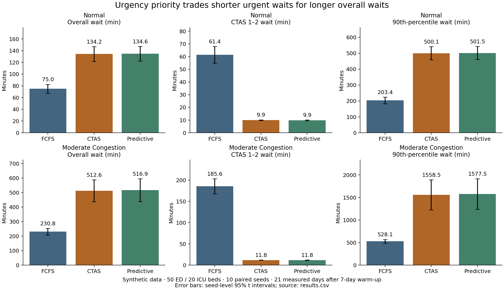

# ED scheduling: urgency prioritization has a measurable trade-off

Prepared 2026-11-01. Synthetic experiment; 10 independent seeds per scenario, 60 runs total.

## Main result

Under Moderate Congestion, CTAS Priority reduced simulated CTAS 1–2 mean waiting time from 185.6 to 11.8 minutes (93.6% lower; paired difference -173.8 minutes, 95% CI -191.2 to -156.4). Overall mean wait increased from 230.8 to 512.6 minutes (difference 281.8, 95% CI 226.5 to 337.1). This is a scheduling trade-off in synthetic data, not evidence of better clinical outcomes. [Source: results.csv, paired_difference rows.]

Predictive Priority versus CTAS alone changed urgent mean wait by -0.01 [-0.15, 0.12] minutes and overall mean wait by 4.23 [1.58, 6.88] minutes. The reservation policy did not provide a broad waiting-time improvement; retain the negative results rather than claim an AI gain.

## Capacity-based scenarios

Both scenarios use 50 ED beds, 20 ICU beds, 8 physicians (15-minute initial assessments), 22 triage nurses (uniform 3–10 minutes), lab throughput 22/hour and imaging throughput 14/hour. CTAS 1–5 proportions are 5.26%, 21.05%, 31.58%, 26.32%, 15.79%. These are inherited experimental assumptions, not Ontario estimates. ED/ICU are separate routing pools, not a modeled ED-to-inpatient pathway.

| Scenario | Target ED load | Expected patients/day | Actual patients/day, mean [95% CI] | ICU offered load | Realized ED service load |
| --- | --- | --- | --- | --- | --- |
| Normal | 77.5% | 323.75 | 321.50 [317.78, 325.22] | 16.75% | 76.32 [75.05, 77.58]% |
| Moderate Congestion | 92.5% | 386.41 | 386.77 [383.30, 390.23] | 19.99% | 92.19 [91.01, 93.38]% |

Arrival calculation: for each CTAS level, calculate the exact expectation of the **clamped** lognormal service time, including probability mass at its bounds. Means for levels 1–5 are 191.59, 248.32, 294.08, 92.63, 48.46 minutes. Weight by CTAS mix and routing probability (ICU probability 70%, 15%, 0%, 0%, 0%). Each arrival contributes 172.356 expected ED bed-minutes and 14.900 ICU bed-minutes. Thus **daily arrivals = target ED load × 50 × 1,440 / 172.356**, and ICU offered load = daily arrivals × 14.900 / (20 × 1,440). Offered load is service demand/capacity, not observed occupancy.

The existing normalized hourly shape and 1.2 peak multiplier are retained. Divide the per-level base hourly rate by mean weekday multiplier (1.00714) so a full week has the target daily average. Independent hourly Poisson counts fluctuate around that mean. Average physician, triage nurse, lab and imaging offered loads are respectively Normal: 42.2%, 6.6%, 19.0%, 17.3%; Moderate Congestion: 50.3%, 7.9%, 22.7%, 20.6%. Peak-period demand can exceed capacity even when average offered load is below 100%.

## Five KPIs and paired comparisons

Values below are equal-weight means across independent seeds, with seed-level Student-t 95% confidence intervals. Percentile results are means of each seed’s patient-level 90th percentile, not a pooled percentile.

### Normal

| Metric | FCFS [95% CI] | CTAS [95% CI] | Predictive [95% CI] |
| --- | --- | --- | --- |
| Overall wait (min) | 74.98 [67.38, 82.59] | 134.23 [121.75, 146.70] | 134.62 [122.14, 147.10] |
| CTAS 1–2 wait (min) | 61.41 [54.82, 67.99] | 9.93 [9.60, 10.25] | 9.87 [9.53, 10.20] |
| 90th-percentile wait (min) | 203.37 [182.49, 224.25] | 500.12 [459.31, 540.93] | 501.45 [460.40, 542.50] |
| ED utilization (%) | 76.41 [75.12, 77.70] | 76.39 [75.10, 77.68] | 76.39 [75.10, 77.68] |
| ICU utilization (%) | 16.26 [15.74, 16.78] | 16.26 [15.74, 16.78] | 16.26 [15.74, 16.78] |
| Completed in 21 days | 6761.70 [6681.30, 6842.10] | 6760.50 [6655.47, 6865.53] | 6760.90 [6656.00, 6865.80] |
| Waiting at end | 24.00 [9.81, 38.19] | 77.90 [40.76, 115.04] | 77.80 [40.73, 114.87] |
| In service at end | 50.30 [45.32, 55.28] | 50.10 [44.83, 55.37] | 50.20 [44.89, 55.51] |
| Total unfinished at end | 74.30 [57.68, 90.92] | 128.00 [88.00, 168.00] | 128.00 [88.00, 168.00] |

| Metric | CTAS − FCFS | Predictive − FCFS | Predictive − CTAS |
| --- | --- | --- | --- |
| Overall wait (min) | 59.24 [53.75, 64.74] | 59.64 [54.17, 65.11] | 0.39 [0.30, 0.49] |
| CTAS 1–2 wait (min) | -51.48 [-57.77, -45.20] | -51.54 [-57.81, -45.27] | -0.06 [-0.11, -0.01] |
| 90th-percentile wait (min) | 296.75 [272.66, 320.84] | 298.08 [273.61, 322.55] | 1.33 [-0.38, 3.04] |
| ED utilization (%) | -0.02 [-0.04, 0.00] | -0.02 [-0.04, 0.00] | 0.00 [-0.00, 0.00] |
| ICU utilization (%) | 0.00 [-0.00, 0.00] | 0.00 [-0.00, 0.00] | -0.00 [-0.00, 0.00] |
| Completed in 21 days | -1.20 [-46.21, 43.81] | -0.80 [-45.40, 43.80] | 0.40 [-0.50, 1.30] |
| Waiting at end | 53.90 [27.91, 79.89] | 53.80 [27.85, 79.75] | -0.10 [-0.51, 0.31] |
| In service at end | -0.20 [-0.76, 0.36] | -0.10 [-0.73, 0.53] | 0.10 [-0.13, 0.33] |
| Total unfinished at end | 53.70 [27.62, 79.78] | 53.70 [27.57, 79.83] | 0.00 [-0.48, 0.48] |

### Moderate Congestion

| Metric | FCFS [95% CI] | CTAS [95% CI] | Predictive [95% CI] |
| --- | --- | --- | --- |
| Overall wait (min) | 230.81 [208.04, 253.58] | 512.63 [436.94, 588.32] | 516.86 [439.00, 594.72] |
| CTAS 1–2 wait (min) | 185.61 [168.13, 203.10] | 11.82 [11.48, 12.15] | 11.80 [11.37, 12.24] |
| 90th-percentile wait (min) | 528.11 [486.19, 570.04] | 1558.47 [1223.89, 1893.05] | 1577.52 [1240.71, 1914.33] |
| ED utilization (%) | 92.22 [91.04, 93.40] | 92.18 [91.05, 93.31] | 92.18 [91.06, 93.30] |
| ICU utilization (%) | 19.50 [18.93, 20.06] | 19.50 [18.93, 20.06] | 19.50 [18.93, 20.06] |
| Completed in 21 days | 8127.60 [8050.17, 8205.03] | 8112.30 [8038.06, 8186.54] | 8110.80 [8037.50, 8184.10] |
| Waiting at end | 138.40 [109.10, 167.70] | 298.20 [240.17, 356.23] | 299.80 [240.36, 359.24] |
| In service at end | 52.60 [51.33, 53.87] | 52.80 [51.69, 53.91] | 52.80 [51.69, 53.91] |
| Total unfinished at end | 191.00 [162.66, 219.34] | 351.00 [293.60, 408.40] | 352.60 [293.78, 411.42] |

| Metric | CTAS − FCFS | Predictive − FCFS | Predictive − CTAS |
| --- | --- | --- | --- |
| Overall wait (min) | 281.82 [226.53, 337.11] | 286.05 [228.62, 343.48] | 4.23 [1.58, 6.88] |
| CTAS 1–2 wait (min) | -173.80 [-191.18, -156.41] | -173.81 [-191.17, -156.45] | -0.01 [-0.15, 0.12] |
| 90th-percentile wait (min) | 1030.36 [726.46, 1334.26] | 1049.41 [743.87, 1354.94] | 19.05 [3.53, 34.57] |
| ED utilization (%) | -0.04 [-0.11, 0.03] | -0.04 [-0.12, 0.04] | -0.01 [-0.02, 0.00] |
| ICU utilization (%) | -0.00 [-0.00, 0.00] | -0.00 [-0.00, 0.00] | -0.00 [-0.00, 0.00] |
| Completed in 21 days | -15.30 [-52.15, 21.55] | -16.80 [-54.70, 21.10] | -1.50 [-4.05, 1.05] |
| Waiting at end | 159.80 [124.09, 195.51] | 161.40 [123.52, 199.28] | 1.60 [-1.40, 4.60] |
| In service at end | 0.20 [-0.25, 0.65] | 0.20 [-0.25, 0.65] | 0.00 [0.00, 0.00] |
| Total unfinished at end | 160.00 [124.23, 195.77] | 161.60 [123.66, 199.54] | 1.60 [-1.40, 4.60] |

Differences are method minus baseline: negative waiting differences mean shorter waits; utilization differences are percentage points. Each interval uses ten paired seed differences (9 degrees of freedom). All relative percentage changes are also in results.csv. Intervals are descriptive and unadjusted for multiple comparisons; ten seeds limit precision. No individual patients are treated as independent experiment replicates.

## Window, backlog and validity

No scenario/method had a weekly backlog-trend or first-to-last-week wait interval excluding zero. This is no clear evidence of accumulating overload over the measured weeks, not confirmation of long-run stability. Moderate CTAS runs still averaged 298 waiting patients at the final midnight snapshot and a 26-hour 90th-percentile wait. These substantial queues limit the realism claim, especially because patients never abandon the queue. The names “Normal” and “Moderate Congestion” describe offered-load targets only.

Arrivals span January 5–February 9, 2026 (35 synthetic days). January 5–12 is warm-up; January 12–February 2 is the 21-day measurement window; another seven arrival days prevent an artificially empty tail. The engine drains all generated patients. Wait outcomes include every measurement-window arrival, including those starting service after the window. Occupancy and completions use calendar time and include warm-up carry-in.

| Scenario / method | Waiting at start → end | Backlog trend, patients/week [95% CI] | Last − first week mean wait, min [95% CI] |
| --- | --- | --- | --- |
| Normal / FCFS | 33.6 → 24.0 | -1.73 [-9.30, 5.84] | 11.78 [-2.18, 25.74] |
| Normal / CTAS | 85.0 → 77.9 | 0.40 [-21.41, 22.21] | 23.54 [-3.39, 50.47] |
| Normal / Predictive | 85.3 → 77.8 | 0.24 [-21.47, 21.95] | 23.49 [-3.62, 50.60] |
| Moderate Congestion / FCFS | 142.6 → 138.4 | -2.32 [-12.09, 7.45] | 6.08 [-33.31, 45.46] |
| Moderate Congestion / CTAS | 287.3 → 298.2 | 2.11 [-16.75, 20.97] | 65.46 [-69.50, 200.41] |
| Moderate Congestion / Predictive | 287.4 → 299.8 | 2.56 [-16.46, 21.58] | 68.61 [-71.32, 208.55] |

Backlog trend fits four weekly snapshots at the same weekday/time per seed; wait drift compares the first and last complete measurement weeks. These are finite-window diagnostics, not proof of stationary behavior. End-of-window queues are real unresolved work and must not be described as zero backlog. Large cyclic queues may remain despite subcritical average offered load. Their plausibility for an actual hospital has not been established.

All measurement patients started service before guard arrivals stopped (maximum count beyond guard: 0); the outcome estimates therefore do not benefit from turning off arrivals. The largest diagnostic-induced bed-service extension was 4.29 minutes (numerical rounding only), supporting the service-demand load calculation. All runs passed timestamp ordering, resource-capacity interval, reservation accounting and patient-conservation checks. For each run: carry-in + arrivals = completions during window + unfinished patients at end. Input stream SHA-256 values match across all three methods within each scenario/seed.

**Definitions:** waiting = arrival to joint bed/initial physician assessment start, including triage and queues; it is not a CIHI arrival-to-physician measure. Urgent wait pools individual CTAS 1–2 patients within each seed. ED/ICU utilization = occupied bed-minutes overlapping the measurement window / (beds × 21 × 1,440). Completed = any patient departing within the window; remaining backlog is reported both as waiting and total unfinished (waiting plus in service).

**Policy:** FCFS and CTAS share resources and nonpreemptive service. CTAS sorts by level then arrival. Predictive uses CTAS plus the existing forecast-driven bed reservations (threshold 0.8 expected urgent arrivals, 30-minute expiration, 15-minute checks). The frozen research predictor was reused without retraining or parameter selection on these seeds. It was trained under different load conditions, so this is also a transfer test; no new forecast-accuracy claim is made.

## Reproduce and inspect

From the repository root, run `python reports/portfolio_result/run_analysis.py`, then `python reports/portfolio_result/build_report.py`. The simulation runner refuses to overwrite results.csv; reproduce in a separate repository copy with a fresh output directory. The report builder only renders saved results. The existing research predictor at `reports/simulation_validation/development/predictor.pkl` is required; it is locally available but ignored by Git. Protocol.json records its SHA-256, source hashes, exact seeds, capacities, rates, dates and package versions. No new model file or training is required.

`results.csv` contains seed-level values, summaries and paired differences, distinguished by record_type; do not add these record types together. `seed_results.partial.csv` is a retained execution checkpoint, not the authoritative final result. `validation.json` records completed checks and historical file preservation. [Source code](run_analysis.py), [configuration](protocol.json), [results](results.csv), [validation](validation.json).

**Scope:** capacity-based synthetic scenarios, not calibrated Ontario hospitals. No CIHI/NACRS aggregate statistics were used here. Routing, staffing, service distributions, absence of abandonment/boarding and strict priority limit realism. The finding supports a portfolio demonstration of experimental design and statistical analysis; it does not establish clinical safety, patient benefit or a deployable scheduling recommendation. Historical results were preserved, with no commit or push.

Daily patient counts for all 420 measured scenario/seed days are in [daily_arrivals.csv](daily_arrivals.csv). Run `python reports/portfolio_result/verify_results.py` to regenerate streams and independently check their hashes, daily totals, service expectations by numerical integration, and every paired confidence interval; it does not rerun the scheduling experiment. The existing regression suite also passed: 33 tests.
