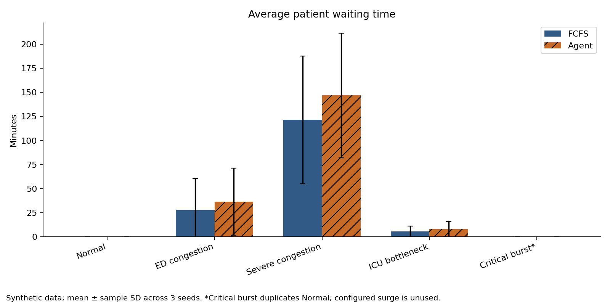
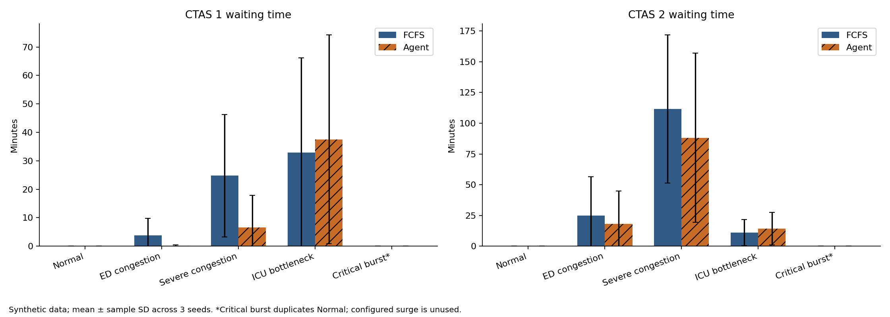
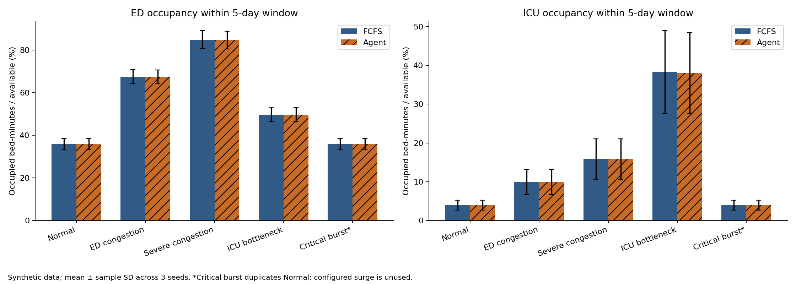
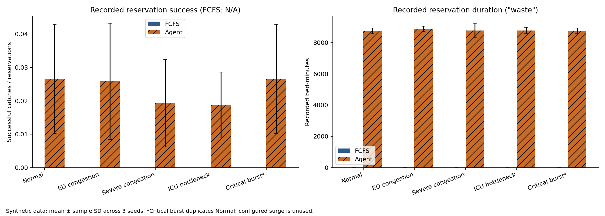

# ED simulation evaluation for resume evidence

Prepared 2026-11-01. Synthetic academic simulation; no hospital outcome or deployment evidence.

## Executive summary

All 30 reproduced runs completed: five named configurations × three seeds × two methods. Each configuration used 752, 742 and 690 generated patients (2,184 patient inputs per configuration), yielding 10,920 scenario-patient inputs and 21,840 method-patient outputs. These are repeated synthetic streams, not 10,920 independent people: arrivals and acuities repeat across scenarios. The strongest defensible achievement is the reproducible comparative analysis and validation, not an overall performance improvement.

The Agent increased average waiting time under ED congestion (27.692 to 36.399 minutes, +31.44%), severe congestion (121.446 to 146.803, +20.88%) and ICU bottleneck (5.479 to 8.004, +46.09%). Under ED congestion, mean CTAS 1 waiting fell from 3.721 to 0.163 minutes (95.62%), and CTAS 2 from 24.966 to 18.109 (27.47%). Those subgroup benefits coexist with worse overall waiting. Only three seeds, with 11, 2 and 13 CTAS 1 patients respectively (and 108, 103 and 105 CTAS 2 patients), support these estimates; they are not clinical efficacy estimates.

The original CLI failed before running simulations (missing Tuple import). A subsequent saved-model smoke test failed because the model expects 13 features but current inference supplies four; its saved sklearn version also differs. Therefore this is explicitly a **reproduced model evaluation**, not a successful execution of the original model. No reservation, prioritization or allocation policy was tuned.

## Architecture and inspected implementation

Sources: `backend/optimization/evaluate_agent.py`, `congestion_scenarios.py`, `backend/simulation/engine.py`, `predictive_engine.py`, `event_model.py`, `backend/data/synthetic_generator.py`, `backend/ml/predictor.py`, `train_model.py`, `backend/agents/resource_allocation_agent.py`, `urgency_scoring_agent.py`, `backend/simulation/realtime_manager.py`, README, datasets, existing evaluation CSVs and test files. Source hashes and package versions are in [manifest](artifacts/manifest.json).

The generator samples daily volumes around 155 multiplied by weekday effects, with 8% Gaussian variability and a 60-patient floor. It applies hourly weights, day/night CTAS probabilities, probabilistic ICU need (70% for level 1, 15% for level 2), clamped log-normal service durations and laboratory/imaging queue estimates. Generated `los_minutes` includes the triage interval; the engines treat all of it as bed service duration. CTAS is sampled here, not derived from symptoms.

Scenario per-level arrival rates, peak multiplier, physicians and nurses do not drive simulated arrivals or staffing constraints. Bed capacities and lab/imaging capacity can matter. Normal and Critical Burst have identical operative inputs and outputs: the latter is not a tested critical surge. The ICU bottleneck simulation fixes patients to their generated bed type; it does not implement the described ED boarding/ICU transfer pathway.

FCFS sorts arrivals and assigns the earliest available bed separately within ED and ICU. PredictiveEngine uses event queues, dynamic effective urgency `level × (1 - min(1, wait / target))`, targets 30/150/230/245/250 minutes for levels 1–5, and arrival-time tie breaking. All urgency scores eventually reach zero; these targets are aging parameters, not guaranteed service limits. Expected L1/L2 count ≥0.8 triggers one reservation in each unit, nominally held 30 minutes. The threshold is an expected count, not an 80% probability. No priority-only ablation was run, so subgroup effects cannot be attributed to prediction alone.

The application is different: UrgencyScoringAgent combines clinical rules, overrides and thresholds; ResourceAllocationAgent sorts a base urgency score plus waiting/risk modifiers and produces bed recommendations and heuristic waits. RealtimeManager loads a different model path and applies occupancy gates to reservations. The scenario evaluator never calls this application workflow, database, chatbot or OpenAI. README assertions about working UI, voice, live allocation and end-to-end integration were not established by this evaluation.

## Environment and model reproduction

Python and all evaluation imports were available; exact versions are in the manifest. requirements.txt does not explicitly list matplotlib, seaborn, python-dateutil or pytest, despite their use here. The only production-source change is importing Tuple in predictive_engine.py. Existing user modifications, model, database and old data/evaluation outputs were preserved. All evaluator writes were redirected into artifacts/ through a working-directory change.

The current four-feature inference (sine/cosine of hour and weekday) was preserved. The existing prepare_training_data function calculates 13 features and next-60-minute L1/L2 labels; the reproduction uses its first four columns, matching inference. The same HistGradientBoostingRegressor parameters are fitted directly on a separate 30-day synthetic normal stream beginning 2026-01-05, seed 202601. A seven-day stream starting 2026-03-02, seed 202602, is validation only. Evaluation begins Monday 2026-10-26, seeds 42–44, and never enters training or model selection. Last-hour training/validation observations are removed to avoid incomplete target windows. No random row split, overlapping training/validation target windows, hyperparameter selection or threshold search was used. This avoids the overlapping-window leakage risk in the existing random 80/20 split; it does not establish generalization to real patients or unseen generators. Original saved-model training provenance is unknown.

Training: 4,570 generated patients, 4,566 complete-window samples. Validation: 1,102 patients, 1,097 samples. Held-out synthetic count MAE 1.068, MSE 1.804, R² -0.112; these are forecasting diagnostics, not clinical accuracy.

## Metric definitions and caveats

- `avg_wait`: arithmetic mean of service_start minus arrival, in minutes. CTAS means use only that level; counts n_l1…n_l5 are retained per seed.
- `avg_los`: evaluator mean of waiting plus input los_minutes, so it is total simulated time in system, not service-only LOS. The unused summarize_simulation_metrics helper instead labels service-only duration average_los and uses a different occupancy denominator; those definitions must not be mixed.
- `ed_occ`/`icu_occ`: min(1, sum of all input service minutes / (5 × 1,440 × beds)). They include service outside the arrival window and do not respond to scheduling; they are capped demand estimates, not observed occupancy.
- `ed_time_occupancy`/`icu_time_occupancy`: added reporting-only measurements. Sum each patient's service interval intersected with [2026-10-26 00:00, 2026-10-31 00:00), divided by 7,200 × capacity. These are actual simulated bed-time occupancy fractions; no policy change was made.
- `total_reservations`, `successful_catches`, `expired_reservations`: original engine counters. A success requires effective urgency exactly 1.0, not simply a high-urgency arrival. Aged patients can consume reservations without incrementing success; outstanding reservations may remain. Success plus expiry therefore need not equal total. Reservation success is not clinical prediction accuracy.
- `wasted_bed_minutes`: engine sums elapsed reservation time on expiration and consumption, including successful consumption. It neither checks whether a reserved bed was physically idle nor counts all pending terminal reservations. Expiry is processed at the next arrival/discharge, not its own scheduled timeout event. This is recorded reservation duration, not a valid measurement of avoidable idle capacity or a financial saving.
- FCFS reservation counts/duration are zero; its success rate is N/A. Original precision field is retained but its zero-denominator zero is not treated as a measured rate. Missing/zero-baseline percentage improvements are blank rather than invented.

## Scenario results

Means ± sample SD (ddof=1) across three seeds, equally weighting seeds within each scenario. These are seed-level means, not pooled patient means; no cross-scenario performance average is claimed.

| Scenario | Method | Wait min | CTAS 1 min | CTAS 2 min | System time min |
|---|---|---:|---:|---:|---:|
| normal | FCFS | 0.000 ± 0.000 | 0.000 ± 0.000 | 0.000 ± 0.000 | 189.780 ± 5.564 |
| normal | Agent | 0.005 ± 0.009 | 0.000 ± 0.000 | 0.000 ± 0.000 | 189.785 ± 5.573 |
| ed_congestion | FCFS | 27.692 ± 32.882 | 3.721 ± 6.026 | 24.966 ± 31.357 | 217.472 ± 38.423 |
| ed_congestion | Agent | 36.399 ± 34.848 | 0.163 ± 0.282 | 18.109 ± 26.685 | 226.179 ± 40.363 |
| severe_congestion | FCFS | 121.446 ± 66.469 | 24.765 ± 21.477 | 111.722 ± 60.259 | 311.226 ± 71.888 |
| severe_congestion | Agent | 146.803 ± 64.639 | 6.519 ± 11.291 | 88.218 ± 68.686 | 336.583 ± 69.970 |
| icu_bottleneck | FCFS | 5.479 ± 5.513 | 32.954 ± 33.308 | 10.942 ± 10.567 | 195.259 ± 10.889 |
| icu_bottleneck | Agent | 8.004 ± 8.031 | 37.557 ± 36.703 | 14.326 ± 13.251 | 197.784 ± 13.453 |
| critical_burst | FCFS | 0.000 ± 0.000 | 0.000 ± 0.000 | 0.000 ± 0.000 | 189.780 ± 5.564 |
| critical_burst | Agent | 0.005 ± 0.009 | 0.000 ± 0.000 | 0.000 ± 0.000 | 189.785 ± 5.573 |




| Scenario | Method | ED occupancy | ICU occupancy |
|---|---|---:|---:|
| normal | FCFS | 0.360 ± 0.027 | 0.040 ± 0.013 |
| normal | Agent | 0.360 ± 0.027 | 0.040 ± 0.013 |
| ed_congestion | FCFS | 0.676 ± 0.033 | 0.099 ± 0.032 |
| ed_congestion | Agent | 0.675 ± 0.033 | 0.099 ± 0.032 |
| severe_congestion | FCFS | 0.849 ± 0.042 | 0.159 ± 0.052 |
| severe_congestion | Agent | 0.847 ± 0.042 | 0.159 ± 0.052 |
| icu_bottleneck | FCFS | 0.497 ± 0.034 | 0.382 ± 0.107 |
| icu_bottleneck | Agent | 0.497 ± 0.034 | 0.380 ± 0.104 |
| critical_burst | FCFS | 0.360 ± 0.027 | 0.040 ± 0.013 |
| critical_burst | Agent | 0.360 ± 0.027 | 0.040 ± 0.013 |

Occupancy fractions above are 0–1; the figure shows percentages. The raw demand estimates and all reservation counters are in evaluation_results.csv.



| Scenario | Method | Reservations | Successes | Expired | Success fraction | Recorded duration min |
|---|---|---:|---:|---:|---:|---:|
| normal | FCFS | 0.000 ± 0.000 | 0.000 ± 0.000 | 0.000 ± 0.000 | N/A | 0.000 ± 0.000 |
| normal | Agent | 261.667 ± 5.508 | 7.000 ± 4.359 | 252.667 ± 3.055 | 0.027 ± 0.016 | 8751.082 ± 177.053 |
| ed_congestion | FCFS | 0.000 ± 0.000 | 0.000 ± 0.000 | 0.000 ± 0.000 | N/A | 0.000 ± 0.000 |
| ed_congestion | Agent | 289.000 ± 40.780 | 7.000 ± 4.359 | 251.667 ± 5.033 | 0.026 ± 0.017 | 8881.384 ± 167.356 |
| severe_congestion | FCFS | 0.000 ± 0.000 | 0.000 ± 0.000 | 0.000 ± 0.000 | N/A | 0.000 ± 0.000 |
| severe_congestion | Agent | 386.667 ± 53.144 | 7.000 ± 4.359 | 222.000 ± 6.928 | 0.019 ± 0.013 | 8769.187 ± 463.120 |
| icu_bottleneck | FCFS | 0.000 ± 0.000 | 0.000 ± 0.000 | 0.000 ± 0.000 | N/A | 0.000 ± 0.000 |
| icu_bottleneck | Agent | 265.000 ± 6.245 | 5.000 ± 2.646 | 249.333 ± 3.215 | 0.019 ± 0.010 | 8775.319 ± 209.482 |
| critical_burst | FCFS | 0.000 ± 0.000 | 0.000 ± 0.000 | 0.000 ± 0.000 | N/A | 0.000 ± 0.000 |
| critical_burst | Agent | 261.667 ± 5.508 | 7.000 ± 4.359 | 252.667 ± 3.055 | 0.027 ± 0.016 | 8751.082 ± 177.053 |



## Calculations, uncertainty and operational interpretation

For lower-is-better metrics, improvement = (FCFS seed-mean − Agent seed-mean) / FCFS seed-mean × 100. kpi_comparison.csv also retains the mean of per-seed percentage improvements separately; it can differ substantially and excludes undefined zero-baseline ratios. Example ED congestion: (27.6923462388 − 36.3991838209) / 27.6923462388 × 100 = approximately −31.44%. Use the full-precision CSV values for exact recalculation.

Severe congestion had the longest overall waits. Its mean CTAS 1 wait fell 73.68% (24.765 to 6.519 minutes), and CTAS 2 fell 21.04% (111.722 to 88.218), while overall waiting increased 25.357 minutes. ICU bottleneck worsened both CTAS 1 (+13.97%) and CTAS 2 (+30.92%) waiting. Normal and duplicated Critical Burst had zero FCFS mean wait and only 0.00534 minutes Agent mean wait; percentage improvement is undefined. The negative overall results are consistent with prioritization and reservation trade-offs but do not isolate their individual causal contributions.

Capacity planning should monitor overall and urgency-specific waits, tail waits, time in system, time-based occupancy, arrivals by urgency, completion/backlog, and actual idle held-bed time. High occupancy alone is not evidence of better care. The existing capped utilization estimate cannot support a utilization improvement claim, and recorded reservation waste cannot support saved-capacity claims. A larger preregistered seed set, priority-only comparison, corrected scenario-generation sensitivity tests and reservation event accounting would distinguish prediction value from scheduling effects. Those would be separate validation work, not retrospective tuning of this benchmark.

## Validation and coverage

All 30 runs completed all patients, with nonnegative waits and peak occupied beds within capacity. build_report.py independently rereads all 30 raw output files, joins each one-to-one to its input, verifies unchanged arrivals/urgency/service/bed type, recomputes waits and time in system from timestamps, CTAS means, clipped occupancy and percentage improvements. validation_checks.csv records those checks. Each FCFS/Agent pair has the same input hash. Inputs are fixed-date and seeded; event ties use object identity in the original engine and could be nondeterministic if exact same-type timestamp ties occur.

`python -m pytest -q`: 5 passed, 6 failed. Four scenario checks and one required-column generator check passed. One obsolete test assumes generator ICU bottlenecks increase LOS (both were 188.47); five legacy wrapper tests fail because generate_patients passes unsupported n to generate_events. These defects were reported rather than changing unrelated code. `python -m backend.agents.test_triage`: five printed clinical-rule examples passed, not a comprehensive clinical validation. The realtime integration script exists but calls the chatbot/service workflow and was not executed. Frontend, external APIs, MySQL, deployment, privacy and clinical safety were not tested.

Existing data/evaluation_scenarios.csv contains a removed moderate_congestion scenario and materially different numbers. It has no demonstrated provenance matching the current generator and was not used as new evidence or overwritten.

## Reproduce and audit

From repository root, with the manifest's Python/package versions available:

```powershell
$env:OMP_NUM_THREADS="1"
python reports/resume_evaluation/run_evaluation.py
python reports/resume_evaluation/build_report.py
python -m pytest -q
python -m backend.agents.test_triage
```

run_evaluation.py calls the existing run_scenarios(days=5, seeds=[42,43,44]) with scoped adapters for fixed dates, the separate model and metric capture. Its generated original-format CSV is artifacts/data/evaluation_scenarios.csv. The untouched CLI still points at the incompatible original model; use the documented runner for this reproduction. Re-running backs up existing artifacts and result CSVs before replacing them. Training/validation datasets, the fitted model, input CSVs, patient outputs, per-run event logs, source hashes and environment metadata are retained. execution.log records the completed run; tests.txt and triage_checks.txt retain test evidence.

Deliverables: evaluation_results.csv (means, SD, minima, maxima), per_seed_results.csv (30 rows), kpi_comparison.csv (75 comparisons), evaluation_summary.md and resume_bullets.md. No SQL/MySQL analysis was performed; no SQL achievement is inferred from a database dependency. Team contribution ownership cannot be established from this run; resume wording should be used only if you can explain and take responsibility for this assisted evaluation.
