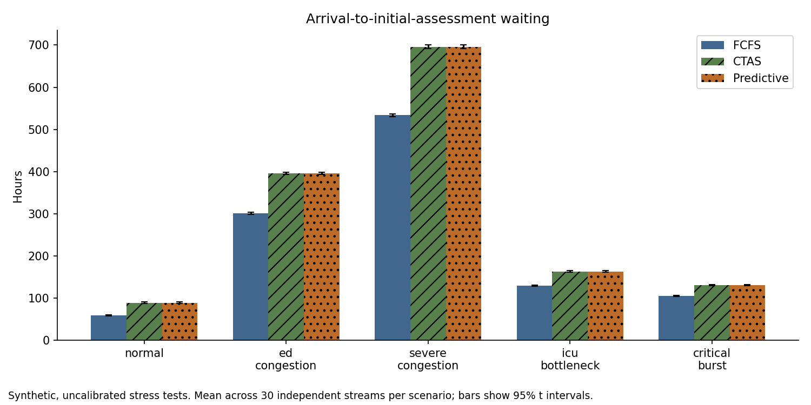
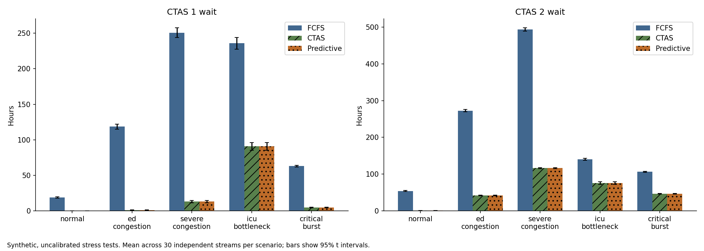
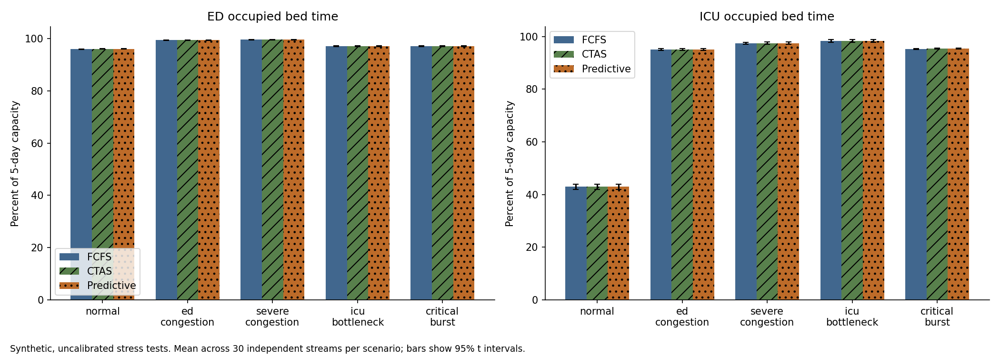
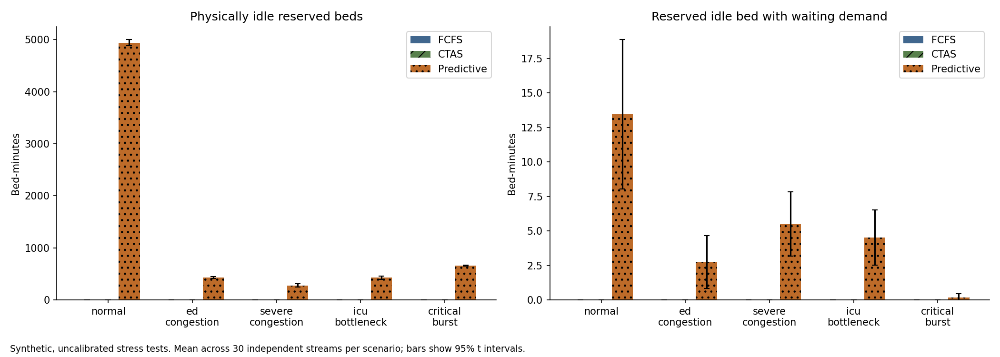

# ED simulation correction and validation

Prepared 2026-11-01. Status: **verified within the synthetic finite-cohort model; not calibrated or externally validated for Ontario**.

## Executive summary

The corrected pipeline completed 450 final comparison runs on 150 independent scenario streams, with 30 streams in each of five scenarios. Each stream was shared unchanged by FCFS, strict CTAS priority and predictive CTAS priority. There were 919,157 synthetic input records and 2,757,471 method-patient outputs. Training used 25 separate streams; validation used 25 further streams (75 comparison runs). No final-test stream was used for fitting, parameter selection or bug-driven performance tuning.

The scenario generator, causal feature contract, reservation lifecycle and KPI calculations were corrected. All automated tests pass (see [test output](tests.txt)), and every final run passed patient conservation and bed/nurse/physician/diagnostic capacity checks. Persisted final outputs were independently reread and reconciled. The original evaluation and model remain unchanged, verified by SHA-256.

CTAS-only priority increased overall mean waiting in all five final scenarios while reducing CTAS 1 and CTAS 2 waiting. Adding reservations increased overall mean waiting by 0.226?1.725 minutes versus CTAS alone. Critical Burst?s paired 95% interval spans zero; the ED-congestion lower bound is only 0.0003 minutes and is not a robust multiple-comparison finding. The forecasting model had lower held-out MAE than both training-mean and last-hour persistence in every scenario; all paired model-minus-persistence MAE intervals were below zero. Better forecasting therefore did not demonstrate better scheduling.

These configured rates are stress loads, including the scenario named Normal. Large queues persist after five arrival days. Correct event execution does not establish a realistic Ontario ED model. The admitted ED departure/boarding pathway is absent; system time must not be presented as NACRS admitted ED length of stay.

## Root causes and what can be concluded

1. **Scenario generation was disconnected from configuration.** The old generator used roughly 155 arrivals/day and fixed day/night CTAS weights, ignoring per-level scenario rates and the peak multiplier. Critical Burst duplicated Normal. The correction activates the configured rates; it does not reduce them to make results look plausible. Old and corrected experiment percentages are therefore not an apples-to-apples estimate of a code-fix benefit.
2. **Predictor contracts disagreed.** Training prepared 13 features; inference supplied four. The old saved model also came from another sklearn version. The earlier resume evaluation deliberately trained a separate four-feature model, with validation R² about −0.112. The new model uses one named, versioned 13-feature extractor for both training snapshots and inference, requires compatible model metadata, and leaves old artifacts intact.
3. **Reservation accounting understated catches and mislabeled waste.** Old catches required aged urgency exactly 1.0; CTAS 2 and aged CTAS 1 patients could consume holds without success. Holds could be created against fully occupied units, expired only on later patient events, and accumulated duration even when no bed was idle. The corrected ledger reconciles every hold and separately measures physical idleness and blocked demand.
4. **Priority and prediction were confounded.** FCFS was compared with priority plus reservations. The new CTAS-only arm isolates the incremental reservation policy under this model. Strict nonpreemptive CTAS priority replaces the old aging formula and its hard-coded targets; this is an explicit policy definition change, not a claimed clinical correction or tuned improvement. FCFS/CTAS use identical resource mechanics.
5. **KPI definitions were inconsistent.** Old avg_los included waiting; an alternative helper excluded it. Old utilization was a capped demand ratio. New metrics use actual timestamps and window-clipped occupied intervals.

The previous negative outcomes are valid observations of that implementation, not proof that one particular bug caused all of the deterioration. Mechanistic defects above are established by code and regression tests; precise contributions to old outcome differences would require a separate historical ablation. Negative corrected results and uncertainty are retained below.

## Corrected methods

**Arrivals and CTAS.** For level c, day d and hour h, N follows Poisson(rate[c] × weekday[d] × normalized_hour_shape[h]). The peak multiplier applies to hours 10–14 before normalization; the hourly shape has mean one, preserving the configured daily-average rate. Within-hour arrivals are uniform. Each configured CTAS rate generates its own counts, so expected CTAS share is rate[c]/sum(rate). Monday–Friday weekday multipliers remain 1.0, 0.9, 0.9, 0.9, 1.0. Local independent NumPy RNG streams generate arrivals and care requirements; capacities do not alter exogenous patient inputs. See [arrival checks](final_test/arrival_calibration_checks.csv) for observed/expected counts and Poisson residuals; these check the generator, not calibration to healthcare data.

**Service and resources.** Existing clamped log-normal service parameters and care-need probabilities are retained as uncalibrated assumptions. Generated los_minutes is explicitly a compatibility alias for bed service requirement, not observed LOS. Generated assessment/departure fields are blank. Nurse triage lasts the sampled 3–10 minutes and is FCFS for all methods. After triage, admission requires a free fixed-type bed and physician. The physician performs a fixed 15-minute initial assessment, then becomes available. Requested lab and imaging services enter explicit sequential queues, each modelled as one throughput server with service time 60/slots_per_hour minutes. Beds remain occupied until both base care and diagnostics finish. Nurse and physician staffing limits apply to these defined tasks, not all care over the whole visit. Senior-staff flags and alert thresholds remain descriptive metadata; no skill-mix capability model is claimed.

**Scheduling.** FCFS orders by arrival. CTAS and Predictive order by clinical level then arrival then stable input sequence. There is no preemption, no shortest-job scheduling and no outcome-tuned aging. Strict priority can impose long lower-acuity waits; finite cohorts eventually drain, but continuous-load starvation is not ruled out. Two fixed ED/ICU pools are used; an unavailable ICU does not silently change the patient's requirement.

**Prediction.** Thirteen features: sine/cosine of hour and weekday, ED/ICU occupied fractions, arrivals in trailing 15/30/60/240 minutes, and active CTAS 1/2/3 counts. Features use only state available at decision time. Forecast samples occur every 15 minutes; labels count CTAS 1/2 arrivals in [t,t+60 minutes). Initial four hours are excluded from forecasting evaluation and training; the last hour is excluded unless its full target window is observed. This does not remove the initial transient from scheduling outcomes. Training snapshots are collected under CTAS-only scheduling; model use under reservations can shift state, which remains a limitation. The estimator is HistGradientBoostingRegressor with the original fixed settings (100 iterations, depth 10, learning rate 0.1, random_state 42).

**Holds.** Every 15 minutes until the fixed five-day horizon, expected CTAS 1/2 count ≥0.8 can reserve at most one physically free bed in each pool, for 30 minutes. No hold is created when a high-urgency patient is already in that pool's waiting queue. Unreserved beds are used first. A CTAS 1/2 patient arriving at/after hold creation consumes the last held free bed and counts as a catch; an older patient needing it cancels the hold. Expiry is a scheduled event and cannot immediately rehold the bed at the same timestamp, allowing the queue to advance. Horizon closure cancels remaining holds; post-horizon draining creates no new holds. Threshold 0.8 is an expected count, not a probability. The shared forecast is not unit-specific; its inability to distinguish demand for ED versus ICU is a substantive policy limitation.

**Reservation measures.** Total holds = successful catches + expired + cancelled. Duration is elapsed hold lifetime. Reserved idle bed-minutes integrate actual free capacity under a hold; under this policy they equal duration by construction because occupied beds cannot be reserved. Blocked idle bed-minutes additionally require a waiting patient, no other free bed in that pool, and a free physician. This is a local opportunity-cost measure, not a causal estimate of total delay or a monetary saving. Reservation success is utilization of holds, not clinical accuracy and not general forecasting precision. Low success can remain because high-urgency patients use other free beds, because a forecast is not unit-specific, or because queues leave no free beds to reserve.

## Prespecified splits and uncertainty

[protocol.json](protocol.json) was written before development runs. For scenario index i (0–4 in repository order), train seeds are 100000+1000i+j (j=0…4), validation seeds 200000+1000i+j (j=0…4), final seeds 300000+1000i+j (j=0…29). All streams cover five arrival days from 2026-01-05 00:00, starting empty and draining to completion. Reusing weekday dates across independent streams does not share patient records. Dates are naive synthetic clocks, with no DST transitions; future Ontario ingestion needs explicit timezone handling.

Development froze code hashes, model hash and protocol hash before final access. The final runner checks them and refuses overwrite. Neither the threshold nor estimator was selected by validation or final results. Same-stream paired comparisons control input randomness. Reported mean/SD/t-based 95% intervals use 30 stream-level values per scenario, never patient rows as independent replications. Paired differences are method minus baseline, so positive waiting-time differences indicate deterioration. Improvement percentages use (baseline mean − method mean)/baseline mean ×100; their percentile bootstrap intervals use 5,000 paired stream resamples with a fixed analysis RNG. Multiple comparisons are descriptive and unadjusted; the intervals quantify Monte Carlo uncertainty conditional on this simulator, not real-world model validity. No overall performance average across different scenarios is reported.

## Final cohort scale

| scenario | streams | patient_inputs | mean_patients | min_patients | max_patients |
|---|---|---|---|---|---|
| normal | 30 | 128112 | 4,270.400 | 4150 | 4464 |
| ed_congestion | 30 | 203776 | 6,792.533 | 6629 | 6936 |
| severe_congestion | 30 | 263217 | 8,773.900 | 8598 | 8924 |
| icu_bottleneck | 30 | 128381 | 4,279.367 | 4107 | 4402 |
| critical_burst | 30 | 195671 | 6,522.367 | 6308 | 6663 |

## Overall waiting: minutes, seed-level mean and uncertainty

| scenario | method | mean | sd | ci95_low | ci95_high |
|---|---|---|---|---|---|
| normal | FCFS | 3,534.570 | 208.758 | 3,456.619 | 3,612.521 |
| normal | CTAS | 5,345.659 | 226.854 | 5,260.950 | 5,430.367 |
| normal | Predictive | 5,346.317 | 226.846 | 5,261.611 | 5,431.022 |
| ed_congestion | FCFS | 18,046.313 | 383.711 | 17,903.033 | 18,189.593 |
| ed_congestion | CTAS | 23,724.424 | 396.625 | 23,576.321 | 23,872.526 |
| ed_congestion | Predictive | 23,725.170 | 396.488 | 23,577.119 | 23,873.221 |
| severe_congestion | FCFS | 32,010.880 | 592.511 | 31,789.633 | 32,232.127 |
| severe_congestion | CTAS | 41,745.099 | 701.617 | 41,483.111 | 42,007.087 |
| severe_congestion | Predictive | 41,746.824 | 702.065 | 41,484.668 | 42,008.979 |
| icu_bottleneck | FCFS | 7,764.492 | 251.592 | 7,670.546 | 7,858.438 |
| icu_bottleneck | CTAS | 9,792.544 | 269.372 | 9,691.959 | 9,893.129 |
| icu_bottleneck | Predictive | 9,793.259 | 269.171 | 9,692.749 | 9,893.769 |
| critical_burst | FCFS | 6,287.750 | 168.512 | 6,224.827 | 6,350.673 |
| critical_burst | CTAS | 7,828.860 | 188.551 | 7,758.453 | 7,899.266 |
| critical_burst | Predictive | 7,829.086 | 188.472 | 7,758.709 | 7,899.462 |



### Separating priority from reservations

| scenario | baseline | method | delta_mean | delta_ci95_low | delta_ci95_high | improvement_pct |
|---|---|---|---|---|---|---|
| normal | FCFS | CTAS | 1,811.089 | 1,793.450 | 1,828.727 | -51.239 |
| normal | CTAS | Predictive | 0.658 | 0.267 | 1.049 | -0.012 |
| ed_congestion | FCFS | CTAS | 5,678.110 | 5,628.256 | 5,727.965 | -31.464 |
| ed_congestion | CTAS | Predictive | 0.747 | 0.000 | 1.493 | -0.003 |
| severe_congestion | FCFS | CTAS | 9,734.219 | 9,653.179 | 9,815.259 | -30.409 |
| severe_congestion | CTAS | Predictive | 1.725 | 0.773 | 2.676 | -0.004 |
| icu_bottleneck | FCFS | CTAS | 2,028.052 | 1,991.747 | 2,064.358 | -26.120 |
| icu_bottleneck | CTAS | Predictive | 0.715 | 0.194 | 1.236 | -0.007 |
| critical_burst | FCFS | CTAS | 1,541.109 | 1,518.912 | 1,563.307 | -24.510 |
| critical_burst | CTAS | Predictive | 0.226 | -0.046 | 0.498 | -0.003 |

The CTAS-versus-FCFS contrast measures the scheduling-order change within the corrected resource model. Predictive-versus-CTAS measures the incremental hold policy. A confidence interval spanning zero does not establish a benefit or prove equivalence. Large FCFS-to-Predictive differences must not all be attributed to forecasting.

### Waiting by urgency (minutes)

| scenario | method | wait_l1 | wait_l2 | wait_l3 | wait_l4 | wait_l5 |
|---|---|---|---|---|---|---|
| normal | FCFS | 1,132.135 | 3,235.962 | 3,781.092 | 3,803.433 | 3,804.256 |
| normal | CTAS | 8.920 | 45.952 | 3,692.913 | 9,277.555 | 10,920.812 |
| normal | Predictive | 8.900 | 45.715 | 3,693.163 | 9,278.421 | 10,923.291 |
| ed_congestion | FCFS | 7,122.344 | 16,364.973 | 19,014.267 | 19,018.236 | 18,991.544 |
| ed_congestion | CTAS | 71.271 | 2,517.469 | 20,327.242 | 36,386.408 | 40,835.740 |
| ed_congestion | Predictive | 71.217 | 2,518.614 | 20,326.406 | 36,386.949 | 40,839.608 |
| severe_congestion | FCFS | 15,047.255 | 29,592.108 | 33,482.633 | 33,361.782 | 33,540.962 |
| severe_congestion | CTAS | 788.199 | 6,976.893 | 35,505.224 | 61,426.789 | 68,895.120 |
| severe_congestion | Predictive | 788.215 | 6,977.306 | 35,503.329 | 61,432.159 | 68,899.625 |
| icu_bottleneck | FCFS | 14,148.014 | 8,431.104 | 6,781.041 | 6,774.280 | 6,766.045 |
| icu_bottleneck | CTAS | 5,448.213 | 4,533.190 | 8,093.488 | 15,009.183 | 16,783.477 |
| icu_bottleneck | Predictive | 5,448.184 | 4,533.421 | 8,093.192 | 15,010.400 | 16,787.279 |
| critical_burst | FCFS | 3,781.630 | 6,371.128 | 7,107.067 | 7,132.105 | 7,108.740 |
| critical_burst | CTAS | 292.109 | 2,781.968 | 10,901.055 | 15,913.669 | 17,560.151 |
| critical_burst | Predictive | 292.428 | 2,781.900 | 10,901.019 | 15,914.840 | 17,560.195 |



Full per-urgency uncertainty, time in system, median/P90 waits, occupancy and cohort completeness are in [scenario_summary.csv](final_test/scenario_summary.csv). Mean seed P90 is not a pooled population percentile.

### Occupancy and unfinished work at the arrival horizon



| scenario | method | waiting_at_horizon | in_service_at_horizon | departed_by_horizon | drain_minutes |
|---|---|---|---|---|---|
| normal | FCFS | 2,074.667 | 57.300 | 2,138.433 | 8,194.402 |
| normal | CTAS | 2,598.467 | 57.467 | 1,614.467 | 8,510.090 |
| normal | Predictive | 2,598.700 | 57.467 | 1,614.233 | 8,510.714 |
| ed_congestion | FCFS | 5,513.033 | 34.000 | 1,245.500 | 38,849.913 |
| ed_congestion | CTAS | 5,738.767 | 34.000 | 1,019.767 | 38,846.660 |
| ed_congestion | Predictive | 5,739.133 | 34.000 | 1,019.400 | 38,846.750 |
| severe_congestion | FCFS | 7,800.400 | 25.000 | 948.500 | 67,695.647 |
| severe_congestion | CTAS | 7,977.900 | 25.000 | 771.000 | 67,779.874 |
| severe_congestion | Predictive | 7,977.900 | 25.000 | 771.000 | 67,780.263 |
| icu_bottleneck | FCFS | 2,879.167 | 38.000 | 1,362.200 | 35,035.709 |
| icu_bottleneck | CTAS | 3,142.967 | 38.000 | 1,098.400 | 35,061.262 |
| icu_bottleneck | Predictive | 3,143.000 | 38.000 | 1,098.367 | 35,060.348 |
| critical_burst | FCFS | 4,058.833 | 69.933 | 2,393.600 | 14,867.104 |
| critical_burst | CTAS | 4,263.367 | 69.933 | 2,189.067 | 15,188.583 |
| critical_burst | Predictive | 4,263.367 | 69.933 | 2,189.067 | 15,188.620 |

### Offered workload relative to five-day resource capacity

| scenario | ed_service_demand_ratio | icu_service_demand_ratio | triage_demand_ratio | initial_assessment_demand_ratio | lab_demand_ratio | imaging_demand_ratio |
|---|---|---|---|---|---|---|
| normal | 2.040 | 0.436 | 0.175 | 1.112 | 0.503 | 0.459 |
| ed_congestion | 6.333 | 1.452 | 0.341 | 2.022 | 0.931 | 0.792 |
| severe_congestion | 10.352 | 2.992 | 0.566 | 3.046 | 1.411 | 1.197 |
| icu_bottleneck | 2.906 | 5.840 | 0.176 | 1.114 | 0.558 | 0.519 |
| critical_burst | 2.979 | 1.624 | 0.267 | 1.699 | 1.082 | 1.096 |

These ratios are input workload / available service capacity, **not occupancy**. A value above one exceeds the resource's five-day capacity even before timing mismatch. Bed-service ratios exclude added diagnostic blocking; physician ratios cover initial assessment only. These measurements help explain backlog without changing demand or claiming Ontario calibration.

Waiting patients are followed through drain, not discarded or assigned zero wait. drain_minutes is time beyond the five-day arrival horizon until the last departure. All resource intervals are checked for capacity violations. These enormous finite-cohort delays and backlogs make current rate/capacity settings unsuitable as empirical Ontario estimates; increasing the number of seeds cannot repair that structural issue.

## Held-out predictive performance

Forecast MAE is measured in CTAS 1/2 arrivals per next hour. Each stream supplies complete-window fixed-grid observations; interval calculations cluster at the stream level. The training-mean baseline uses training data only. Persistence predicts the preceding hour's high-urgency count. Neither baseline uses future labels or final-set fitting.

| scenario | predictor | mean | ci95_low | ci95_high |
|---|---|---|---|---|
| normal | model | 2.562 | 2.488 | 2.637 |
| normal | training_mean | 8.018 | 7.923 | 8.113 |
| normal | persistence_60m | 3.501 | 3.422 | 3.581 |
| ed_congestion | model | 2.987 | 2.931 | 3.043 |
| ed_congestion | training_mean | 8.115 | 8.003 | 8.227 |
| ed_congestion | persistence_60m | 4.486 | 4.405 | 4.567 |
| severe_congestion | model | 3.349 | 3.268 | 3.430 |
| severe_congestion | training_mean | 9.502 | 9.349 | 9.656 |
| severe_congestion | persistence_60m | 5.186 | 5.082 | 5.290 |
| icu_bottleneck | model | 2.691 | 2.623 | 2.758 |
| icu_bottleneck | training_mean | 7.824 | 7.742 | 7.906 |
| icu_bottleneck | persistence_60m | 4.078 | 3.984 | 4.172 |
| critical_burst | model | 4.490 | 4.380 | 4.599 |
| critical_burst | training_mean | 17.373 | 17.236 | 17.510 |
| critical_burst | persistence_60m | 7.163 | 7.044 | 7.283 |

[Forecast paired MAE contrasts](final_test/forecast_paired_mae.csv) report model minus baseline with 95% intervals; negative values favor the model. RMSE, bias and R² are also available in [forecast_summary.csv](final_test/forecast_summary.csv), with per-window truth/predictions retained in compressed raw forecast files. Better count forecasts do not establish improved scheduling, suitable calibration, or clinical prediction accuracy.

## Reservation ledger: totals across 30 streams per scenario

| scenario | total_reservations | successful_catches | expired_reservations | cancelled_reservations | reservation_duration_minutes | reserved_idle_bed_minutes | blocked_idle_bed_minutes | pooled_success_rate |
|---|---|---|---|---|---|---|---|---|
| normal | 5049 | 113 | 4856 | 80 | 148,206.490 | 148,206.490 | 403.727 | 0.022 |
| ed_congestion | 451 | 23 | 417 | 11 | 12,988.795 | 12,988.795 | 82.385 | 0.051 |
| severe_congestion | 316 | 46 | 252 | 18 | 8,352.184 | 8,352.184 | 165.204 | 0.146 |
| icu_bottleneck | 452 | 42 | 402 | 8 | 12,824.267 | 12,824.267 | 135.691 | 0.093 |
| critical_burst | 676 | 21 | 644 | 11 | 19,753.191 | 19,753.191 | 5.565 | 0.031 |

The pooled success fraction here uses sum(catches)/sum(holds); per-seed rates and their seed-mean uncertainty are separately retained. FCFS and CTAS have no holds and an undefined success rate, not zero accuracy.



## KPI definitions and Ontario boundary

- Arrival: generated registration time; assumed no earlier triage. Actual nurse triage start/end are retained separately.
- wait: physician initial assessment start minus arrival. In this model it includes triage and bed/physician queue delays and is not a pure bed-queue metric.
- system time: physical simulated resource departure minus arrival, not the input service duration. It includes ICU treatment when the patient is routed to ICU and is therefore not generally ED LOS.
- ED/ICU occupancy: sum of each bed-service interval intersected with the fixed five-day window, divided by capacity ×7,200 minutes. It is not capped; impossible occupancy is detected by capacity assertions.
- Missing urgency/disposition strata produce NaN, not invented zero waits. Incomplete patients cause KPI calculation to fail rather than hide censoring.
- P50/P90 use NumPy linear interpolation and retain units in minutes. Benchmark export must explicitly convert to hours and verify the source's quantile convention and exclusions.

Only official **definitions** were consulted. CIHI defines initial physician wait from the earlier of registration or triage to initial assessment, and admitted ED total time ends when the patient actually leaves the ED. See [CIHI initial assessment](https://www.cihi.ca/en/indicators/emergency-department-wait-time-for-physician-initial-assessment) and [CIHI admitted ED time](https://www.cihi.ca/en/indicators/total-time-spent-in-emergency-department-for-admitted-patients). No Ontario aggregate statistics were used or claimed as validation. [Ontario readiness](ontario_benchmark_readiness.md) and [benchmark contract](benchmark_contract.json) specify required sources, cohorts, missing pathway work, calibration/validation separation and explicit status gates.

## Verification, preservation and reproducibility

The six prior failing tests were resolved: the fixed-count compatibility wrapper now returns exactly n consistently generated records with legacy fixture IDs; the invalid assertion that ICU capacity alters generated service duration was replaced with a controlled queue test where fewer ICU beds increase waiting on identical service inputs. New tests cover all five scenarios' rate/CTAS expectations, fixed RNG behavior, peak normalization, resource queues, FCFS/CTAS ordering, disabled-prediction equivalence, deterministic ties, exact expiry, future CTAS 2 catches, terminal reconciliation, no full-bed reservation, KPI window clipping, missing strata, feature persistence and no future-feature contamination.

Every comparison run was checked against its original inputs, for nonnegative ordered timestamps, patient conservation, occupied resource intervals and complete reservation accounting. All 2,757,471 final raw patient rows were reread to reconcile waits, system time and percentiles; every reservation ledger was reread for counts and durations. [validation_checks.csv](final_test/validation_checks.csv) and [persisted_output_audit.csv](final_test/persisted_output_audit.csv) retain evidence. Every paired metric difference was independently recomputed from saved per-seed values. Historical file hashes and the original model hash were verified unchanged.

Sources before edits are preserved under before/. The previous [resume evaluation](../resume_evaluation/evaluation_summary.md), its negative results and original model were not overwritten. Corrected source files are copied under source_snapshot/; protocol/environment/model fingerprints are retained in development/frozen.json and final_test/environment.json. Existing user changes in the chatbot, server, README, database and app requirements were preserved. Predictor changes build on the existing edited file; no Git commit or push occurred. The live application's separate realtime workflow and model path were not deployed or clinically validated; incompatible legacy models fail with a clear retraining error rather than being silently adapted.

On a fresh checkout/copy with the frozen source and protocol (do not overwrite evidence):

```powershell
python -m pip install -r backend/optimization/requirements-evaluation.txt
$env:OMP_NUM_THREADS="1"
python -m pytest -q
python -m backend.optimization.validate_simulation --phase develop
python -m backend.optimization.validate_simulation --phase final
python -m backend.optimization.report_validation
```

Completed output directories deliberately cause the runner to stop. For a rerun, use a separate working copy containing the source and protocol but no development/final_test outputs. New methodological changes require a new version and fresh untouched final seeds; these final streams are now consumed. The compatibility scenario CLI delegates to this workflow. Old threshold/duration sweeps and historical report scripts must use their archived source if reproduced, because the feature and metric schemas have intentionally changed.

## Remaining limitations

No real-hospital calibration or deployment; no admitted ED-to-ward transfer/boarding, dynamic staffing/skill mix, ambulance diversion, abandonment, re-triage, preemption, inpatient discharge dynamics, geography/case-mix calibration or clinical outcome model. Static independent service draws and Poisson arrivals may understate real clustering/dependence. The five-day Monday–Friday experiment does not establish weekend, seasonal or steady-state performance. Initial assessment requires a bed by construction; real ED workflows may assess patients elsewhere. Disposition is an exogenous synthetic flag, not a modelled admission decision. The 13-feature model is evaluated on independent streams from the same generator, so good synthetic forecast scores do not establish external validity.

The deliverable is ready for a separately designed calibration stage with these gaps explicit; it is **not ready to claim agreement with Ontario CIHI/NACRS outcomes**.
